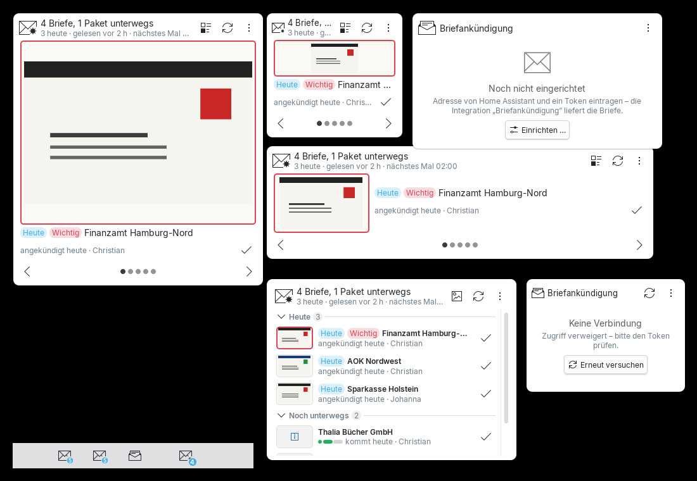
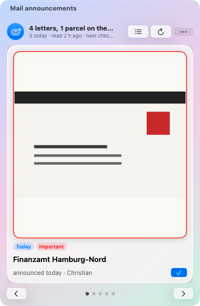
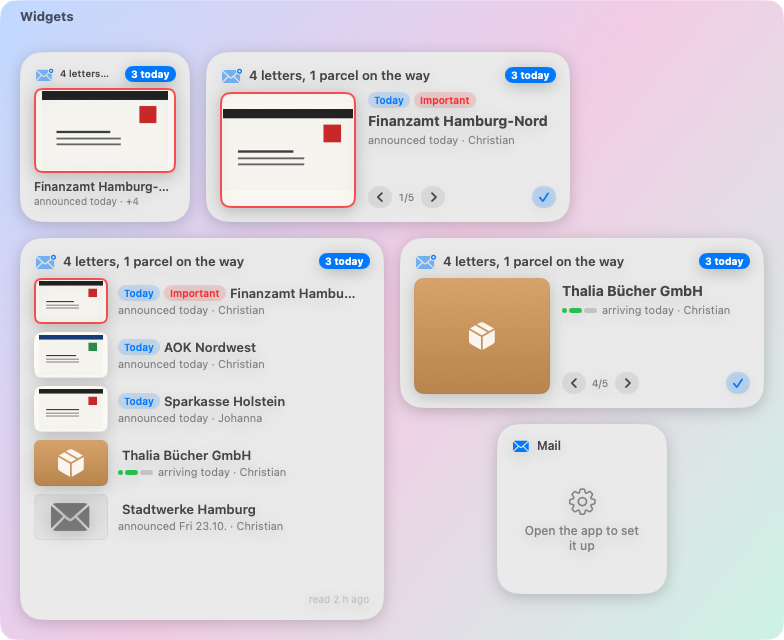

# Briefankündigung – Desktop (Plasma 6 & macOS)

**Angekündigte Briefe der Deutschen Post und Pakete von DHL, Hermes, DPD und Amazon – auf dem Schreibtisch.**
Ein Widget für KDE Plasma 6 und eine native macOS-App (Menüleiste + Schreibtisch-Widgets) für die
Home-Assistant-Integration [Briefankündigung](https://github.com/Teyro/Briefankuendigung-HA): sehen, wer geschrieben
hat, bevor der Brief im Kasten liegt – mit dem Bild des Umschlags.

## Bilder

| Plasma: Kacheln auf dem Schreibtisch | macOS: Menüleiste | macOS: Widgets |
|---|---|---|
|  |  |  |

## Funktionen

- **„3 Briefe unterwegs“** auf einen Blick – die Umschläge als Karten durchblättern (wischen, Mausrad, Pfeile oder
  von selbst) oder als Liste: **Heute · Noch unterwegs · Angekommen**
- Umschlagbilder der Post, **DHL-Pakete** mit Fortschritt (unterwegs → kommt heute → zugestellt) und
  Sendungsverfolgung, **wichtige Absender** (Finanzamt, Gericht …) hervorgehoben
- **Pakete** von **DHL, Hermes, DPD und Amazon** in einem eigenen Reiter: voraussichtliche Zustellung mit
  Zeitfenster („kommt morgen, 10:00–13:00“), „zur Abholung bereit“, Logo in den Farben des Dienstes, passender
  Verfolgen-Link, Kundenkonto bei mehreren Amazon-Konten – und **Sendung per Nummer selbst hinzufügen**
- **„Angekommen“** – abgehakt gilt über Home Assistant auf allen Geräten
- **„Jetzt nachsehen“** – Home Assistant liest das Postfach sofort
- Mehrere Postfächer (z. B. deins und Johannas) – alle oder eins
- Lädt kurz nach jedem Blick der Integration ins Postfach neu (z. B. 2:00 und 5:00 Uhr)
- **Updates mit einem Klick** und „Was ist neu?“, Deutsch und Englisch

### KDE Plasma 6
- Frei skalierbare **Kachel auf dem Schreibtisch**: große Karten, bei breiter Kachel Umschlag neben dem Text,
  bei kleiner nur das Symbol mit Zahl
- Im Panel: Symbol mit Zahl (hervorgehoben, wenn heute etwas kommt), Liste im Popup
- Übernimmt die Verbindung automatisch aus der **Home Assistant ToolBox**, falls installiert
- Je Kachel wählbar: alles (mit Reitern), nur Briefe oder **nur Pakete** – z. B. zwei Kacheln nebeneinander

### macOS (ab 14 Sonoma, Liquid Glass ab macOS 26)
- Menüleisten-App mit Karten und Liste, Fenster mit allen Briefen
- **Schreibtisch-Widgets** (klein, mittel, groß) – im Widget durchblättern und „Angekommen“ antippen
- Eigenes **Pakete-Widget**, sortiert nach voraussichtlicher Zustellung
- Token im Schlüsselbund; kann die Verbindung aus der Home Assistant ToolBox übernehmen

## Voraussetzung

Home Assistant mit der Integration [Briefankündigung](https://github.com/Teyro/Briefankuendigung-HA) **ab 1.3** (HACS; Pakete von Hermes, DPD, Amazon und Sendung hinzufügen: **ab 1.4**)
und ein langlebiges Zugriffstoken (unten links auf den Namen → Sicherheit).

## Installieren

**Plasma:** `briefankuendigung.plasmoid` aus den [Releases](https://github.com/Teyro/Briefankuendigung-Desktop/releases) laden,
dann `kpackagetool6 -t Plasma/Applet -i briefankuendigung.plasmoid` (oder *Widgets hinzufügen → Neue holen → Aus Datei installieren*).
„Briefankündigung“ auf den Schreibtisch oder ins Panel legen und in den Einstellungen Adresse und Token eintragen.

**macOS:** `Briefankuendigung-macOS-x.y.z.zip` laden, entpacken, App in *Programme* ziehen. Die App ist nicht
notarisiert: beim ersten Start Rechtsklick → *Öffnen*. Widgets: Rechtsklick auf den Schreibtisch →
*Widgets bearbeiten* → Briefankündigung.

## Datenschutz

Die Apps sprechen nur mit deinem Home Assistant (und mit GitHub, um nach Updates zu sehen).
Unter Plasma liegt der Token in den Widget-Einstellungen, unter macOS im Schlüsselbund.

Lizenz: GPL-3.0-or-later
